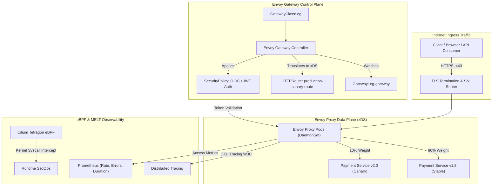

# Envoy Gateway & Kubernetes Gateway API Production Platform (`tp-envoy-gateway`)

[](https://slsa.dev)
[](https://talaripradeep.info)
[](LICENSE)
[](https://github.com/Pradeeptalari14/tp-envoy-gateway/actions)

> **Production Repository:** [`Pradeeptalari14/tp-envoy-gateway`](https://github.com/Pradeeptalari14/tp-envoy-gateway)  
> **Interactive Studio Workspace:** [https://talaripradeep.info/tools/envoy-gateway/](https://talaripradeep.info/tools/envoy-gateway/)  
> **Visual Flow Canvas:** [https://talaripradeep.info/studios/flow/?studio=envoy-gateway](https://talaripradeep.info/studios/flow/?studio=envoy-gateway)  
> **Architecture Center:** [https://talaripradeep.info/architecture/](https://talaripradeep.info/architecture/)

---

## 🏛️ Production Architecture Flow



---

## 🛡️ Core Engineering & 9+ DevSecOps / SRE Governance Principles

This platform implements the **9+ enterprise DevSecOps and SRE governance principles**, ensuring audited supply-chain security, zero-drift declarative state, and automated resilience:

| Governance Pillar | Implementation in Envoy Gateway Platform | Production Guarantee |
|---|---|---|
| **1. Cosign SLSA L3** | Keyless image signing via GitHub Actions OIDC and Rekor transparency ledger | Blocks unsigned or tampered Envoy data plane binaries |
| **2. Semgrep AST** | Static AST policy rules scanning HTTPRoute YAMLs and ingress configurations | Prevents open redirects, route shadowing, and insecure CORS |
| **3. CycloneDX SBOM** | Syft-generated CycloneDX SBOM with Grype zero-day CVE gating | Guarantees zero High/Critical vulnerabilities in gateway base |
| **4. Kyverno Admission** | Validating admission controllers requiring non-root execution and drop-ALL capabilities | Enforces CIS Kubernetes benchmark 5.2 for all ingress pods |
| **5. eBPF Tetragon** | In-kernel socket and namespace inspection on incoming network connections | Real-time threat detection and zero-overhead network profiling |
| **6. GitOps Zero-Drift** | ArgoCD/Flux automated reconciliation against Git repository state | Reverts unauthorized out-of-band ingress route changes |
| **7. MELT Signals** | Golden Signals telemetry (Latency P99, Traffic RPM, Error 5xx %, Saturation) | Instant Prometheus threshold alerting and Grafana visualization |
| **8. Automated SRE Repair** | Automated Canary rollback circuit if HTTP 5xx errors exceed 0.5% threshold | Protects SLA/SLO uptime during continuous application delivery |
| **9. Zero-Trust mTLS** | Strict SPIFFE/mTLS cryptographic identity between Envoy and backend pods | Eliminates lateral eavesdropping and man-in-the-middle risks |

---

## 💻 Infrastructure & Software Technology Stack

| Architectural Layer | Technology & Tools | Production Role |
|---|---|---|
| **API Ingress Standard** | Kubernetes Gateway API v1.0 (GWClass, Gateway, HTTPRoute) | Cloud-native, vendor-neutral declarative ingress specification |
| **Data Plane Proxy** | Envoy Proxy v1.29+ (C++ high-performance engine) | Sub-millisecond L4/L7 routing, rate limiting, and circuit breaking |
| **Control Plane** | Envoy Gateway Operator & Controller | Translates Kubernetes Gateway API CRDs into dynamic xDS configurations |
| **Identity & Security** | SecurityPolicy CRD, OIDC / OAuth2, cert-manager TLS | Cryptographic identity verification and automated TLS termination |
| **Observability & SRE** | OpenTelemetry, Prometheus, Grafana, Cilium Tetragon eBPF | Distributed request tracing, RED metrics, and kernel network telemetry |
| **Deployment & GitOps** | Helm 3, ArgoCD, Cosign, Kyverno Admission Controller | Audited GitOps synchronization with SLSA Level 3 provenance |

---

## 🎯 Where to Use (Real-World Production Scenarios)

### 1. Zero-Downtime Canary Traffic Splitting
Safely test cutting-edge microservice releases in production by routing an exact 90/10 traffic split. Envoy dynamically balances backend weights without pod restarts or DNS delays.

### 2. Centralized Enterprise OIDC Authentication & API Protection
Enforce single sign-on (Okta, Keycloak, Google Workspace) at the ingress boundary using `SecurityPolicy`. Requests reaching microservices are pre-authenticated with validated JWT claims.

### 3. Multi-Tenant Ingress Consolidation & Cross-Namespace Routing
Empower autonomous product teams to manage their own `HTTPRoute` manifests in application namespaces while platform SREs control cluster-wide `Gateway` listeners and TLS policies.

---

## 📋 Step-by-Step SRE Deployment & Verification Runbook

### Phase 1: In-Cluster Gateway API Deployment
```bash
# 1. Install Gateway API CRDs and Envoy Gateway Helm chart
kubectl apply -f https://github.com/kubernetes-sigs/gateway-api/releases/download/v1.0.0/standard-install.yaml
helm install eg oci://docker.io/envoyproxy/gateway-helm --version v1.0.0 -n envoy-gateway-system --create-namespace

# 2. Apply production Gateway and Canary HTTPRoute
kubectl apply -f gateway.yaml
```

### Phase 2: Health Verification & Traffic Validation
```bash
# Verify Gateway and HTTPRoute status
kubectl get gateway,httproute -A -o wide

# Check listener programmed condition
kubectl get gateway eg-gateway -n envoy-gateway-system -o jsonpath='{.status.conditions[?(@.type=="Programmed")].status}'

# Test Canary Traffic Split (Expect ~90% v1, ~10% v2 responses)
for i in {1..20}; do
  curl -ks https://api.talaripradeep.info/api/v1/payments | jq .version
done
```

### Phase 3: SRE Triage & Failure Remediation Matrix
| Incident Symptom | Underlying Root Cause | Rapid SRE Remediation Command |
|---|---|---|
| **HTTP 503 Service Unavailable** | Upstream backend pods failing readiness probes or misconfigured port | `kubectl describe endpoints payments-v1` & check backend container health |
| **TLS Handshake Error (SSL Alert 46)** | Missing TLS Secret or cert-manager ACME challenge pending | `kubectl get certificate,secret -n envoy-gateway-system` |
| **Route Ignored / 404 Not Found** | ParentRef namespace mismatch between Gateway and HTTPRoute | Verify `parentRefs[0].namespace` matches the Gateway location |
| **Canary Error Spike (5xx > 1%)** | Defective Canary build deployed to payments-v2 | Roll back weight to `0` in `gateway.yaml` and trigger immediate GitOps sync |

---

## 🚀 Quickstart & Verification Drill

```bash
# 1. Clone repository
git clone https://github.com/Pradeeptalari14/tp-envoy-gateway.git
cd tp-envoy-gateway

# 2. Run automated validation script
chmod +x scripts/validate.sh
./scripts/validate.sh
```

---

## 📄 License & Security Policy

- **License**: [MIT License](LICENSE) — Copyright (c) 2026 Talari Pradeep. All rights reserved.
- **Security Policy**: See [SECURITY.md](SECURITY.md) for vulnerability disclosure and triage workflows.

---
*Synchronized with [Talari Pradeep Developer Studios](https://talaripradeep.info/studios/) & [Repository Learning DAG](https://talaripradeep.info/tools/repo-learning/)*
